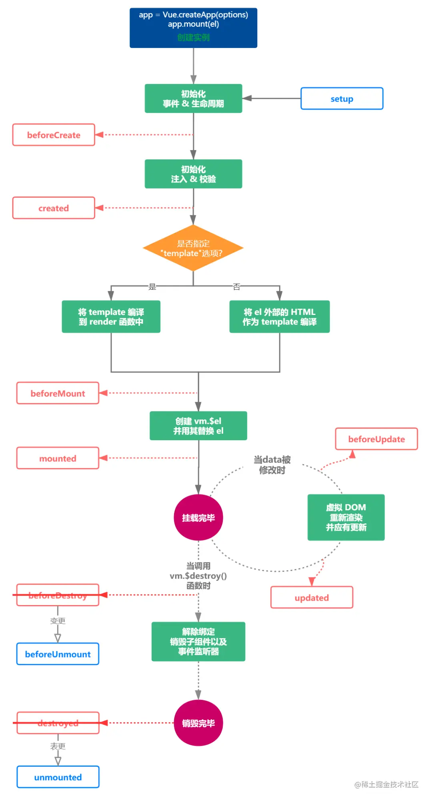

# vue3
## 生命周期 
- ;

## ref 和 reactive 的区别
- ref 用于定义一个响应式的数据
- reactive 用于定义一个对象类型的响应式数据。
  - 他不可以直接用于定义基本数据类型。
  - 不可以结构赋值，会导致丢失响应。
  - 可以使用toRef和toRefs将reactive对象转换为ref对象。
```js
const count = ref(0)
const person = reactive({ name: 'xdd' })
const person2 = toRefs(person)
console.log(count.value) // 0
console.log(person.name) // xdd
```
